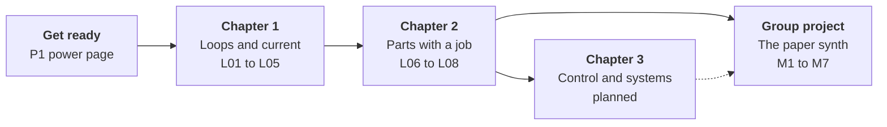
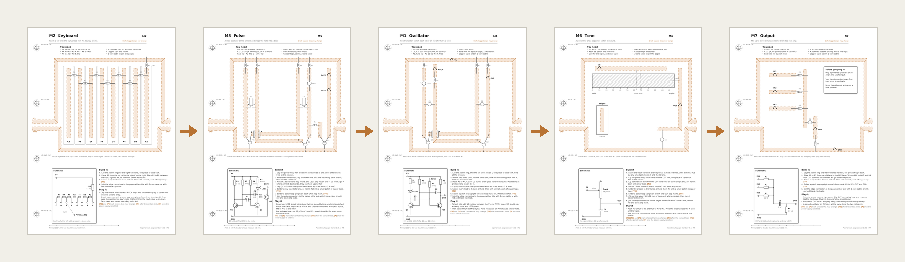

# PaperCircuits


A printable A4 paper-circuit workbook. Circuits are built from copper tape and real through-hole parts, one idea per page. It starts with one LED on one page and ends with a whole group building a synthesizer together.

## From one page to a group build



1. **One page, one idea.** Each lesson is a single page you build alone: lay the tape, place the parts, then predict, measure and explain. Lessons live in a binder, and every one takes its power from P1 through the binder holes.
2. **Ideas that carry forward.** Each lesson leaves you with something the later pages reuse: a pencil line as a resistor, resistors in a row, a capacitor that takes time to charge.
3. **Pages that work together.** In the group project each person builds one page. The pages come out of the binder, lie side by side on a table, and join into one instrument.

## 1 · Get ready

Build the power page first. Every lesson plugs into it through the binder.

| Page | What it is |
|---|---|
| [P1 Power](out/P1-power.pdf) | 3 × AA, a switch and a resettable fuse, feeding V+ and GND to every page in the binder ([teacher notes](docs/lessons/P1.md)) |
| [L00 Template](out/template.pdf) | The blank lesson page: zones, shared nets and every drawing mark, to practise laying tape |

## 2 · The lessons

Each lesson page has the same parts: a build zone, a circuit diagram, and Predict, Measure and Explain boxes. Every lesson has [teacher notes](docs/lessons/).

### Chapter 1 · Loops and current

| Lesson | You build | You find out |
|---|---|---|
| [L01 LEDs only work one way](out/L01-led-polarity.pdf) | Two LEDs on one switch, one printed backwards | Current needs a complete loop, and an LED only lets it go one way |
| [L02 Two switches, two ways](out/L02-and-or.pdf) | Two switch pairs, one in a row and one side by side | AND and OR: the first step towards logic |
| [L03 Draw a resistor](out/L03-pencil-resistor.pdf) | A 6B pencil track with a sliding wiper that dims an LED | A pencil line is a resistor; longer means more resistance |
| [L04 Resistors set the current](out/L04-resistors.pdf) | Three LEDs behind 220 Ω, 1 kΩ and 4.7 kΩ | Bigger resistance, less current, and how to read the colour code |
| [L05 Two ways to add a resistor](out/L05-series-parallel.pdf) | Five equal resistors: one alone, two in a row, two side by side | Resistors in a row add up; side by side, they halve |

### Chapter 2 · Parts with a job

| Lesson | You build | You find out |
|---|---|---|
| [L06 Diodes are one-way valves](out/L06-diodes.pdf) | A diode in each loop, one reversed | A diode costs about 0.7 V, and the voltages round a loop add up to the supply |
| [L07 Share the voltage](out/L07-dividers.pdf) | Three pairs of resistors in a row | Two resistors split the supply in proportion to their size |
| [L08 Store some charge](out/L08-capacitor.pdf) | A big capacitor that keeps an LED lit after the power goes | A capacitor stores charge and lets an LED fade out slowly |

### Chapter 3 · Control and systems (planned)

Transistors as switches, pages working together over the binder's BUS A and BUS B, and a move to a real circuit board. Not drafted yet.

## 3 · The group project: a paper synth



Each person builds one module page. The pages lie side by side, power runs along the row on short cables, and clip leads carry the sound from page to page. M7 sends it off the table to a real amp or powered speaker, which is the only thing that makes it loud.

The sound flows left to right: a **controller** (M2, M3 or M4) sets the note, **M5** chops it into a beat, **M1** makes the tone, **M6** softens it, and **M7** sends it out. A group of three can play with just M2, M1 and M7. Every page is a draft; the [project notes](docs/projects/paper-synth.md) cover setting up the table, the numbers behind each page, safety and common faults.

| Page | Its job in the synth | Builds on |
|---|---|---|
| [M1 Oscillator](out/M1-oscillator.pdf) | Two transistors switch each other on and off: the tone | L08's capacitor timing, plus transistors (chapter 3) |
| [M2 Keyboard](out/M2-keyboard.pdf) | Eight keys on a ladder of resistors; a clip lead is the stylus | L04, and L05's resistors in a row |
| [M3 Pencil ribbon](out/M3-pencil-ribbon.pdf) | A pencil ribbon and wiper for notes that glide | L03's pencil resistor and wiper |
| [M4 Light pitch](out/M4-light-pitch.pdf) | A light sensor you play with your hand's shadow | L05's resistors side by side, and a new part: the LDR |
| [M5 Pulse](out/M5-pulse.pdf) | M1's circuit slowed right down, chopping the note into a beat | M1, with L08's bigger capacitors |
| [M6 Tone](out/M6-tone.pdf) | A pencil track and a capacitor that take the buzz off the sound | L03's pencil and L08's capacitor |
| [M7 Output](out/M7-output.pdf) | Mixes the sound and cuts it to line level for an amp | L07's divider and L08's capacitor |

**Safety:** plug M7 only into a powered speaker's or an amp's line (AUX) input, with the volume turned down first. Never headphones, and never a bare speaker.

## 4 · Behind the pages

Every page follows one [page standard](docs/page-standard.md) (v0.1, draft). Some of its choices are still provisional, and each is tagged on the pages: **[T0]**, **[T1]** or **[P]**. The test sheets settle them, and their results go in the [test log](docs/test-log.md).

| Test sheet | What it decides |
|---|---|
| [T0 Contact tests](out/T0-contact-tests.pdf) | Tape joints, attaching parts, binder hole contacts and switch contacts: the **[T0]** tags |
| [T1 Pencil contacts](out/T1-pencil-contacts.pdf) | Pencil-treated tape glue, joining tape to pencil, and which paper to build on: the **[T1]** tags |
| [T2 Two-sided tests](out/T2-two-sided.pdf) | Whether the back of the page can carry copper too: vias, edge wraps and stacking |

### On the bench


The lesson page template (L00) built in copper tape, with a 100 Ω resistor soldered across its 10 mm gap. The meter reads 99.2 Ω, so the solder joints add almost nothing.

## Printing

Print at 100 % ("actual size"), never "fit to page". Every page has a 100 mm bar in the footer; check it with a ruler.

T2 is the one exception to single-sided printing: print its pages 1 and 2 double-sided, flipping on the long edge, then check the registration marks before laying any tape.

## Build

```bash
uv run build.py
```

This writes the PDFs to `out/` and PNG previews to `docs/img/`. From those previews it also composes the README's two pictures, `docs/img/hero.png` and `docs/img/synth-table.png`. Previews need `pdftoppm` from poppler.

Commit `out/` and `docs/img/` along with the code. Every pull request runs the same build on GitHub Actions. The check fails if:

- two copper lanes on a page are closer than the standard allows
- the committed PDFs don't match what the code builds
- a preview wasn't re-rendered after its PDF changed

The last check compares fingerprints in `docs/img/previews.sha256` rather than images, because poppler renders slightly differently on each platform.

For development, run the fast checks before rebuilding artifacts:

```bash
uv run pytest
uv run ruff check .
uv run ruff format --check .
uv run build.py --check
```

`build.py --check` builds into a temporary directory and does not modify `out/` or
`docs/img/`. To add a sheet, add its output filename and module once to the ordered
`SHEETS` registry near the top of `build.py`.

## Code

Every page is built in three layers, one source of truth each. [docs/page-layers.md](docs/page-layers.md) explains them and how to make or change a page.

- **Circuit** (`papercircuits/circuit.py`): the page's parts, with real values, and the nets they join. The "You need" list and the labels on footprints and schematic symbols are read from it.
- **Placement** (`papercircuits/placement.py`): lanes belong to nets and parts are placed by ref. Its check fails the build if a lead lands on the wrong net, a net has more than one strip of copper, a patch loop is off its lane, or a part is missing from the schematic.
- **Words** (`papercircuits/words.py`): each page's text lives in a Markdown file beside its module, such as `papercircuits/sheets/m7_output.md`. Text can use `{T0}`-style tags, values the page counts, such as `{lanes}`, values from the circuit, such as `{R1.count}`, and shared snippets from `papercircuits/sheets/shared.md`. Test sheets and the template have the words layer only.

The rest of the package:

- `papercircuits/standard.py`: every number from the standard. It must agree with the spec.
- `papercircuits/draw.py`: an A4 canvas in standard coordinates (mm, origin top-left, y down).
- `papercircuits/elements.py`: standard elements such as the spine, tape lanes, test points and part footprints.
- `papercircuits/schematic.py`: circuit-diagram symbols for the schematic panel.
- `papercircuits/provisional.py`: the `[T0]`, `[T1]` and `[P]` tags for choices that wait on an open decision.
- `papercircuits/lesson.py`: what every lesson page shares: the You need and Build it columns, schematic panel and workbook boxes.
- `papercircuits/module.py`: what every table-top module page shares: the power ring, edge connectors and layout.
- `papercircuits/testsheet.py`: what the T-series test sheets share: result columns, steps and tables.
- `papercircuits/drc.py`: the clearance check every page runs before it's saved.
- `docs/electrical-checks.md`: the conservative circuit-graph checks and the analogue properties they intentionally do not claim to prove.
- `papercircuits/sheets/`: one module and one words file per sheet. Add new sheets to `SHEETS` in `build.py`.
- `tools/plant.py`: plants a mistake in a sheet and reports whether the build catches it.
