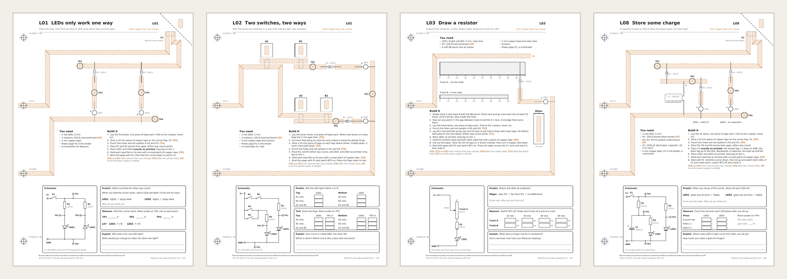
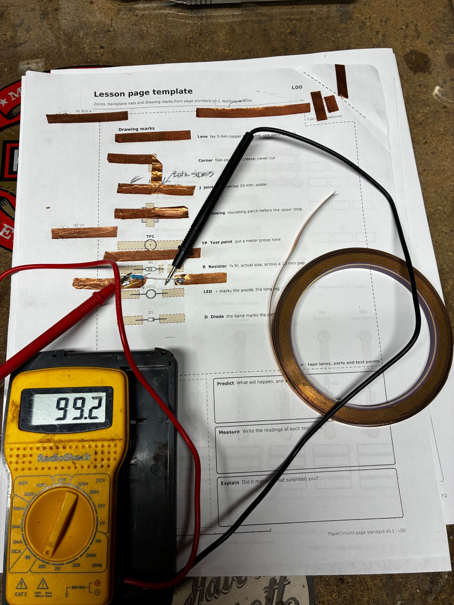

# PaperCircuits



Printable A4 paper-circuit workbook pages. Circuits are built from copper tape and real through-hole parts, and pages bind into a shared power-and-signal backplane through the binder holes.

| File | What it is |
|---|---|
| [docs/page-standard.md](docs/page-standard.md) | The page standard every sheet follows (v0.1 draft) |
| [docs/test-log.md](docs/test-log.md) | Bench results from the T-series tests, which decide the provisional tags |
| [out/T0-contact-tests.pdf](out/T0-contact-tests.pdf) | Contact tests to run before fixing the standard |
| [out/T1-pencil-contacts.pdf](out/T1-pencil-contacts.pdf) | Pencil tests: pencil-treated tape glue, joining tape to pencil, and comparing papers |
| [out/template.pdf](out/template.pdf) | Lesson page template: zones, nets and drawing marks |
| [out/P1-power.pdf](out/P1-power.pdf) | Power page P1: 3 × AA, resettable fuse, feeds H2/H3 (draft; [teacher notes](docs/lessons/P1.md)) |
| [out/L01-led-polarity.pdf](out/L01-led-polarity.pdf) | Lesson L01: LEDs only work one way (draft; [teacher notes](docs/lessons/L01.md)) |
| [out/L02-and-or.pdf](out/L02-and-or.pdf) | Lesson L02: two switches, two ways, AND and OR (draft; [teacher notes](docs/lessons/L02.md)) |
| [out/L03-pencil-resistor.pdf](out/L03-pencil-resistor.pdf) | Lesson L03: draw a resistor, a pencil-track dimmer (draft; [teacher notes](docs/lessons/L03.md)) |
| [out/L04-resistors.pdf](out/L04-resistors.pdf) | Lesson L04: resistors set the current, with the colour code (draft; [teacher notes](docs/lessons/L04.md)) |
| [out/L05-series-parallel.pdf](out/L05-series-parallel.pdf) | Lesson L05: two ways to add a resistor, series and parallel (draft; [teacher notes](docs/lessons/L05.md)) |
| [out/L06-diodes.pdf](out/L06-diodes.pdf) | Lesson L06: diodes are one-way valves (draft; [teacher notes](docs/lessons/L06.md)) |
| [out/L07-dividers.pdf](out/L07-dividers.pdf) | Lesson L07: share the voltage, voltage dividers (draft; [teacher notes](docs/lessons/L07.md)) |
| [out/L08-capacitor.pdf](out/L08-capacitor.pdf) | Lesson L08: store some charge, a capacitor fades an LED (draft; [teacher notes](docs/lessons/L08.md)) |
| [out/M1-oscillator.pdf](out/M1-oscillator.pdf) | Paper synth M1: oscillator, the tone (draft; [project notes](docs/projects/paper-synth.md)) |
| [out/M2-keyboard.pdf](out/M2-keyboard.pdf) | Paper synth M2: stylus keyboard, one octave of C major (draft) |
| [out/M7-output.pdf](out/M7-output.pdf) | Paper synth M7: mixer and line output to a real amp (draft) |

## On the bench



The lesson page template (L00) built in copper tape, with a 100 Ω resistor soldered across its 10 mm gap. The meter reads 99.2 Ω, so the solder joints add almost nothing. Bench results go in the [test log](docs/test-log.md).

## Chapters

1. **Loops and current:** L01 LEDs only work one way · L02 two switches, two ways · L03 draw a resistor · L04 resistors set the current · L05 two ways to add a resistor
2. **Parts with a job:** L06 diodes · L07 voltage dividers · L08 capacitors
3. **Control and systems** (not drafted yet): transistors, pages working together on BUS A and BUS B, and a real circuit board

**Projects:** the **paper synth** is a table-top group build. Pages lie side by side, power runs between them on a short cable, and clip leads patch the sound. M1 oscillator, M2 keyboard and M7 output are drafted; see the [project notes](docs/projects/paper-synth.md).

Build P1 first: every lesson takes its power from P1 through the binder.

## Build

```bash
uv run build.py
```

This writes the PDFs to `out/`, PNG previews to `docs/img/`, and the headline image `docs/img/hero.png` from four of those previews. Previews need `pdftoppm` from poppler.

Commit `out/` and `docs/img/` along with the code. Every pull request runs the same build on GitHub Actions. The check fails if:

- two copper lanes on a page are closer than the standard allows
- the committed PDFs don't match what the code builds
- a preview wasn't re-rendered after its PDF changed

The last check compares fingerprints in `docs/img/previews.sha256` rather than images, because poppler renders slightly differently on each platform.

## Code

- `papercircuits/standard.py`: every number from the standard. It must agree with the spec.
- `papercircuits/draw.py`: an A4 canvas in standard coordinates (mm, origin top-left, y down).
- `papercircuits/elements.py`: standard elements such as the spine, tape lanes, test points and part footprints.
- `papercircuits/schematic.py`: circuit-diagram symbols for the schematic panel.
- `papercircuits/provisional.py`: the `[T0]` and `[P]` tags for choices that wait on an open decision.
- `papercircuits/lesson.py`: what every lesson page shares: the You need and Build it columns, schematic panel and workbook boxes.
- `papercircuits/drc.py`: the clearance check every page runs before it's saved.
- `papercircuits/testsheet.py`: what the T-series test sheets share: result columns, steps and tables.
- `papercircuits/sheets/`: one module per sheet. Add new sheets to `SHEETS` in `build.py`.

## Printing

Print at 100 % ("actual size"), never "fit to page". Every page has a 100 mm bar in the footer; check it with a ruler.
