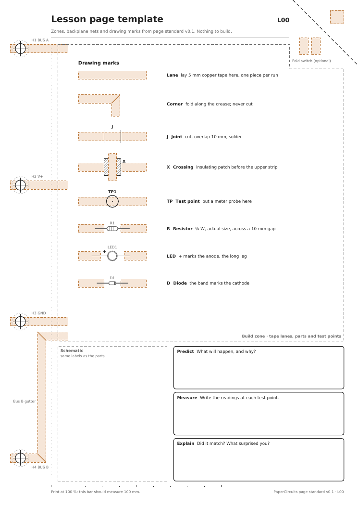

# Paper Circuits page standard — v0.1 (draft)

Every page in the workbook follows this standard: lessons, power pages, module pages, overlays and test sheets. That way any page can be bound with any other and share power and signals through the binder.

Items marked **[T0]** are provisional. The [T0 contact tests](../out/T0-contact-tests.pdf) decide them, and v0.2 of this standard records the results. Bench results so far are in the [test log](test-log.md).

The numbers in this document are also in [`papercircuits/standard.py`](../papercircuits/standard.py), which draws every page. If you change one, change the other.

## 1. Sheet

| Item | Rule |
|---|---|
| Size | A4 portrait, 210 × 297 mm |
| Build pages | 160–200 gsm card, copper on the front only. **[T1]** compares other papers. |
| Overlays | Vellum or tracing paper, about 90–110 gsm, no copper |
| Printing | At 100 % ("actual size"), never "fit to page". Every page has a 100 mm scale bar in the footer to check this. |
| Ink | Every page must read correctly on a black-and-white printer. Colour is only a tint. |
| Printable area | Nothing important outside x 5–205, y 5–292 (printer margins) |
| Binding edge | Left, long edge |

**Coordinates:** millimetres, with the origin at the top-left corner of the front face, x to the right and y downward. All positions below use this.

## 2. Spine and shared nets (the backplane)

Each page has four holes. The inner pair matches the ISO 838 two-hole pattern. All four match the common four-hole pattern with an 80 mm pitch.

| Hole | Centre (x, y) | Net | Notes |
|---|---|---|---|
| H1 | (12, 28.5) | BUS A | Signal bus |
| H2 | (12, 108.5) | V+ | ISO 838 two-hole |
| H3 | (12, 188.5) | GND | ISO 838 two-hole |
| H4 | (12, 268.5) | BUS B | Signal bus |

- **Hole size:** Ø6 mm. Keep everything else at least 8 mm from a hole centre, because an eyelet flange is about Ø10 mm.
- **Why power is on the inner pair:** a standard two-ring binder can still power the book. Four rings add the two signal buses.
- **Spine zone** (x 0–30): holds only hole connections and the Bus B gutter.
- **Connecting to a net:** run a net strip from the hole into the page.
- **Unused holes:** a page that doesn't use a net leaves its hole bare, still punched for alignment, and printed `NC`.
- **Entry points into the build zone** (at x = 30):

  | Net | Entry y |
  |---|---|
  | BUS A | 28.5 |
  | V+ | 108.5 |
  | GND | 188.5 |
  | BUS B | 197 |

- **Bus B gutter:** H4 sits beside the workbook band, so Bus B runs right from H4 to the gutter at x = 24.5. It climbs to y = 197, then turns right into the build zone, 3.5 mm clear of the GND strip. The gutter (x 22–27, y 194–271) is reserved for this.
- **Hole connection [T0]:** the four candidates are:
  - bare punched tape, no eyelet
  - a brass eyelet clamping a 5 mm strip
  - an eyelet on 12 mm tape
  - an eyelet soldered to the strip
- **Binding hardware [T0]:** ring binder or brass Chicago screws (binding posts). Use plain brass or nickel parts. Scrapbooking eyelets are often painted aluminium and don't conduct.

## 3. Zones (lesson pages)

| Zone | x (mm) | y (mm) | Contents |
|---|---|---|---|
| Spine | 0–30 | 0–297 | Holes, net strips, Bus B gutter |
| Header | 30–170 | 6–22 | Title, one-line objective, page ID at the right |
| Switch corner | 172–210 | 0–38 | Optional fold switch (§6) |
| Build | 34–202 | 26–200 | Tape lanes, parts, test points; excludes the switch corner |
| Schematic | 34–98 | 203–282 | Circuit diagram, using the same part labels as the build zone |
| Workbook | 102–202 | 203–282 | Predict / Measure / Explain boxes |
| Footer | 30–202 | 284–291 | Page ID, standard version, 100 mm scale bar |

Test sheets (T series) may use the build, schematic and workbook zones freely. They must keep the spine, header and footer.

## 4. Copper tape

- **Width:** standard tape is 5 mm. Use 12 mm only where a page says so.
- **Lanes:** each strip is printed as a lane, a band of the tape's width with a light tint and a dashed outline. Lay the tape over the lane.
- **One continuous strip per run.** Turn corners by folding along the printed diagonal crease. Most copper tape has non-conductive glue, so two overlapping pieces don't reliably connect.
- **One strip per node.** Every lead on a node lands on the same strip. Where a node has three or more connections, route the strip past each lead rather than branching, because a T-junction is an overlap joint.
- **Joints:** where a joint can't be avoided, it is marked `J` and soldered. **[T0]** decides whether any unsoldered overlap is acceptable, and **[T1]** tests whether rubbing pencil into the glue makes overlaps conduct.
- **Clearance:** at least 3 mm, edge to edge, between different nets. Switch pairs (§6) are the only exception.
- **Checked on every build.** Each lane is its own node, so the generator measures every pair of lanes on a page and fails the build if any are closer than 3 mm. A sheet declares its switch pairs (2 mm) and insulated crossings (0 mm) as the only allowed exceptions.
- **Pencil is not wire.** A pencil track (§5) is a resistor. Keep pencil out of every gap between nets: a smudge across a gap is a leak.
- **Crossings:** marked `X`. Lay a 10 × 10 mm insulating patch (paper or clear tape) before the upper strip.

## 5. Parts and test points

- **Footprints** are printed at actual size, with a part label next to each (R1, D1, LED1…).
- **Polarity:**
  - LEDs: the anode is marked `+`, and its leg outline is drawn longer.
  - Diodes: the cathode band is drawn.
  - Electrolytic capacitors: the − stripe is drawn along the body's edge. A capacitor connected backwards can heat up and fail, so every page that uses one says so in its steps.
- **Two-lead parts** bridge a 10 mm gap with their leads lying flat on the tape. The gap is between two lane ends, or between a lane end and a strip passing by.
- **Lead attachment [T0]:** candidates:
  - M1: flat leads under clear tape
  - M2: flat leads under a copper patch
  - M3: spiral leads under a copper patch
  - M4: soldered
- **Pencil tracks** are hatched bands with a solid outline and a tick every 10 mm. Shade them with a 6B pencil, pressing hard, for at least 10 passes. Hold a metal lead flat on a track with clear tape. Plain copper tape may not join a track, because its glue faces the pencil. **[T1]** tests lead-on-pencil and tape-on-pencil joins.
- **Cut-out pieces** such as a wiper are printed on the page with a solid cut line and a tape strip to stick on before cutting.
- **Test points** are Ø7 mm circles on a lane, labelled `TPn`, with the lane running underneath. Every node a learner is asked to measure gets one.

## 6. Switches

Every switch is a paper flap with a copper pad that folds onto a **switch pair**: two lanes of different nets running side by side, 2 mm apart (7 mm centre to centre). The flap pad is a 10 mm piece of 5 mm tape. Folded down, it lands across both lanes and connects them. A dashed outline on the page shows where it lands.

- **Switch pairs** are the only place two nets may run closer than 3 mm. Keep the pair straight, and separate the lanes again once they're past their last landing.
- **Gap and pad [T0]:** T0 test 4 measures pressed contact and flicker, and compares a 2 mm gap with 3 mm. If 3 mm works as well, v0.2 widens the gap and switch pairs lose their exception.
- **Momentary:** card springs back, so a switch is on only while it's pressed.

### 6.1 Corner switch (optional)

- **Fold line:** from (172, 0) to (210, 38).
- **Pads:** the flap pad is a vertical strip centred at (196, 12). Folding the corner forward lands it as a horizontal strip centred on (184, 24).
- **Lanes:** the switch pair is the ends of two vertical lanes, V+ in at x = 180.5 and V+ out at x = 187.5, both ending at y = 21.5.
- **Wiring:** the page's V+ runs through the switch, so a page only draws current while its corner is pressed. A fault on one page then can't drain the whole book.

### 6.2 Tab switch

- **Flap:** 14 × 16 mm, cut on three sides (solid line) and hinged on the fourth (dotted line), 2 mm clear of the pair it folds onto.
- **Pad:** the flap pad is the mirror image of its landing across the hinge.
- **Keep clear:** nothing else may sit in the flap's cut-out area or its landing area.
- **Series and parallel:** switches in series zig-zag between the pair's two rows; switches in parallel share one pair. L02 shows both.

## 7. Power [provisional]

- **Power page (P series):** 3 × AA (4.5 V), with a resettable PTC fuse (about 100 mA hold) in series with V+ before H2. A short anywhere in the book then trips the fuse instead of heating the tape.
- **P1** ([out/P1-power.pdf](../out/P1-power.pdf), [notes](lessons/P1.md)):
  - BT1 is a holder with its own on/off switch, which is the book's master switch.
  - F1 is a PTC fuse with 0.1 A hold.
  - A green LED with 1 kΩ, after the fuse, lights whenever the book is live.
  - The holder is about 16 mm thick, so P1 goes last in the binder.
- **Current:** design each page for 20 mA or less. With pages switched by their fold switches, F1's 0.1 A hold allows about four pages on at once, plus P1's own 2.4 mA.
- **Coin cells:** not on pages that connect to the backplane. Whether they are allowed on standalone pages depends on the audience's age, which is still undecided.

## 8. Page IDs

| ID | Type |
|---|---|
| `Tn` | Test sheet |
| `Lnn` | Lesson page |
| `Pn` | Power page |
| `Mn` | Module page for system lessons (uses BUS A/B) |
| `…-O` | Overlay for a page, e.g. `L04-O` |

The ID appears at the right of the header and in the footer.

## 9. Drawing conventions

| Mark | Meaning |
|---|---|
| Tinted band, dashed copper outline | Lay copper tape here |
| Solid diagonal across a lane corner | Fold the tape here; don't cut |
| Two ticks across a lane, labelled `J` | Joint: cut and overlap 10 mm, solder if marked |
| Hatched square, labelled `X` | Crossing: insulate before laying the upper strip |
| Circle, labelled `TPn` | Test point: put a meter probe here |
| Circle with crosshair, dashed ring | Punch here; the dashed ring is the eyelet flange |
| Grey outline with leads | Part footprint at actual size |
| Body with a striped edge, both legs from one end | Electrolytic capacitor: the stripe marks the − leg |
| Solid line round a flap, dotted hinge | Tab switch: cut the solid line, crease the dotted one |
| Thin dashed box across a switch pair | Where the flap pad lands |
| Grey hatched band, solid outline, ticks | Pencil track: shade with a 6B pencil |
| Solid outline round a tape strip, "cut out" | A piece to cut out, such as a wiper |
| Copper `[T0]` tag | Provisional: waits on the T0 contact tests |
| Copper `[P]` tag | Provisional: waits on the power decision (§7) |
| Copper `[T1]` tag | Provisional: waits on the T1 pencil tests |

Every page with tags says "Draft: tagged steps may change" in its header and explains the tags under its build steps. Tagged choices live in constants at the top of each sheet module, so settling a decision is a one-line change per page.

Text uses Bitstream Vera (bundled with reportlab), never smaller than 6 pt.

## 10. Open questions

1. **Audience age.** Decides coin cell vs AA, whether soldering is allowed, and how deep the theory goes.
2. **Kept or reused.** Is the workbook consumable, or a reusable class set?
3. **Hardware.** T0 test 3 decides the hole treatment and the binding.
4. **Overlay printing.** Inkjet on vellum can smudge, so laser may be needed.
5. **Paper.** Which card to build on. T1 compares smooth card, heavier card, cartridge paper, coated card and 80 gsm paper.

## Changelog

- **v0.1:** first draft.
- **v0.1, revised while drafting L01:** added one strip per node; fold-switch half-pads are now lane ends; Bus B enters at y = 197.
- **v0.1, revised while drafting L02:** added switch pairs and tab switches. Flap pads are now a 10 mm piece of 5 mm tape (the old 8 mm square couldn't be cut from 5 mm tape), which moved the corner switch to (196, 12) → (184, 24).
- **v0.1, revised while drafting L03:** added pencil tracks, cut-out pieces, and the rule that pencil is not wire.
- **v0.1, revised while drafting L04–L08:** added the electrolytic capacitor footprint and the automatic clearance check.
- **v0.1, revised with T1:** added the T1 pencil tests, the `[T1]` tag, and paper as an open question.
